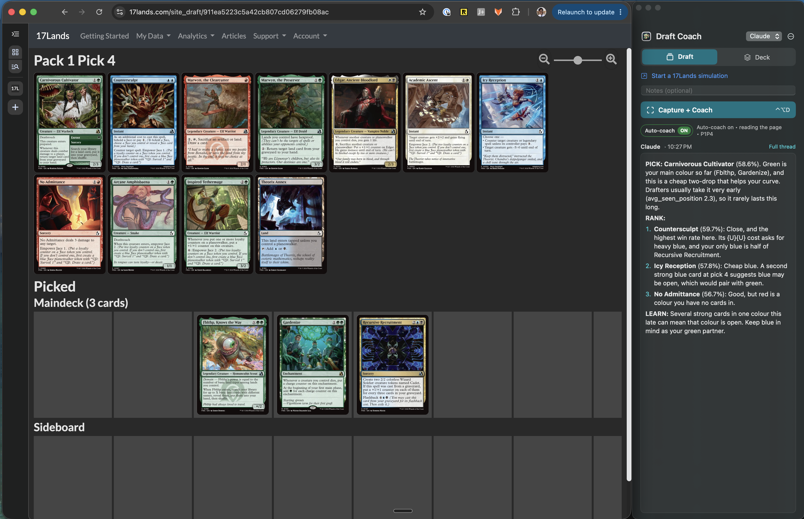

# Draft Coach 🦉

Brief coaching for your 17Lands drafts: what to pick, what to avoid, and why.



**Requires:** an Apple Silicon Mac (M1+), macOS 14+, Google Chrome, and access to Claude Code or a compatible local Codex installation.

## Get started

1. **[Download the app](https://github.com/attaluris/mtg-draft-coach/releases/latest/download/Draft-Coach-macOS-arm64.zip)**, unzip it, and drag **Draft Coach.app** into **Applications**.
2. **Open Draft Coach.** If macOS blocks it and you trust the app, go to **System Settings → Privacy & Security → Open Anyway**.
3. **Connect a coach — choose one:**

   **Claude:** open **Terminal** and paste these commands (skip the first if Claude Code is already installed):

   ```sh
   curl -fsSL https://claude.ai/install.sh | bash
   "$HOME/.local/bin/claude"
   ```

   Follow the sign-in prompts, then choose **Claude** in Draft Coach.

   **Codex:** open a local chat in the Codex app on this Mac and paste:

   ```text
   Set up my installed Draft Coach app to use this chat for coaching.
   Find this chat's ID and verify that my Codex CLI supports `queue`.
   Quit Draft Coach, set its macOS preferences in local.sritej.draftcoach:
   backend = codex, thread = this chat's ID. Reopen Draft Coach and verify
   the settings. Preserve my other preferences. Help me enable Chrome
   Automation and Screen Recording if needed. Don't send a test request.
   ```

   Your coach account's access and usage limits apply.

4. **[Start a practice draft](https://www.17lands.com/mock_draft)** in Chrome. Log in, choose a set, and click **Start!**
5. **Click Capture + Coach**, allow Chrome access and Screen Recording, then turn on **Auto-coach every pick** for automatic advice. If needed, enable Draft Coach under **System Settings → Privacy & Security → Screen Recording**, then quit and reopen the app.

Keep the draft tab active in Chrome and make your picks yourself on 17Lands. For manual coaching, press **Control–Option–D**.
